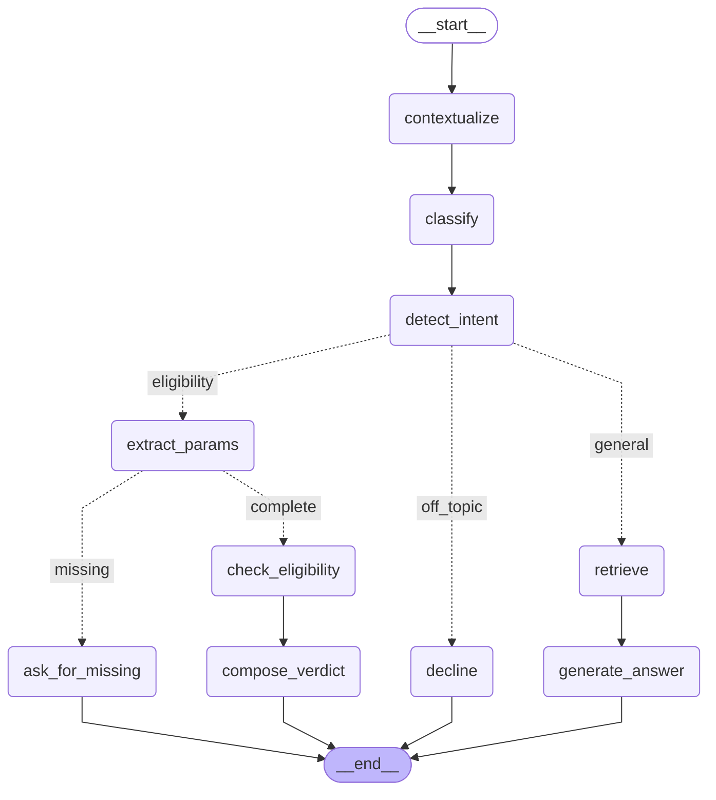

# SunGrid Copilot: Design Notes (Part C)

SunGrid Copilot answers member questions from 14 knowledge-base docs and calls the eligibility
service for rooftop rebate eligibility. Numbers below come from our eval runs (`evals/`).

## 1. How we'd evaluate it before shipping

We wrote tests alongside each part as we built it (31 unit and guard tests now), so every
piece was checked as soon as it existed: the chunker, the filter rules, the eligibility hard
gate, and that `stub_tools.py` was never edited.

On top of that we built a golden set of 35 questions written from the docs and checked it
two ways:

- **Exact checks in code:** right category, right route, the right chunk retrieved, the tool
  called with the right inputs, and no amount when someone isn't eligible. All at 100%.
- **DeepEval metrics with an LLM judge**, for what code can't check: Faithfulness 0.99, Answer
  Relevancy 0.96, Contextual Precision 0.95, Contextual Recall 1.00, Tool Correctness 1.00,
  and a G-Eval rubric for the hard gate at 1.00.

We first ran the DeepEval metrics in hybrid mode, where Jev makes the yes/no calls and the LLM
writes the reasons. The results looked off, so we ran the same metrics with the LLM alone and
read the failures ourselves. The LLM judge was right: hybrid marked correct answers as
unfaithful (0.84 vs 0.99) and quoted probabilities that weren't in our answers, and it gave
padded answers 0.98 for relevancy where the LLM judge caught it (0.76, going up to 0.96 once
we fixed the padding). So the LLM is the default judge.

What surprised me most: Jev is fast and reliable for short decisions like category and intent,
but as a judge it wasn't reliable when the decision needs a lot of text, like checking every
claim against five retrieved chunks. That matches TypeSafe's own note that accuracy drops when
the input has a lot of unrelated content. (One comparison on 23 cases, so a finding, not a
rule.)

With all of that passing, we'd ship it as a pilot.

**Once it's live:** we'd add monitoring with Pydantic Logfire, which the prototype doesn't have
yet, and watch:

- **Low-confidence categories:** how often the top category is below a set level, meaning the
  classifier is unsure and retrieval may be searching the wrong place.
- **"Not in the docs" answers:** questions the knowledge base can't answer, i.e. content gaps.
- **Abandoned eligibility checks:** the agent asked for details and the member never finished,
  which points to a confusing question or too many questions.
- **Latency per step:** the per-node timings the app already records.
- **Cost per conversation:** each question makes several model calls.

Conversations that look wrong get reviewed and added to the golden set, so it keeps growing
from real member questions.

## 2. What breaks first at scale

**10x documents.** Right now we have 14 docs and 69 chunks, every doc was tagged by hand in
`config/categories.yaml`, and the chunker assumes clean `##` sections. Both stop working at
10x: tagging 140 docs by hand is slow and easy to get wrong, and real documents (PDFs, long
pages, missing headings) won't follow our structure, because real life is messy. What we'd
change:

- New chunker rules for documents that don't follow the current structure.
- A reranker, because more documents means more chunks that look almost the same and crowd
  the top 5.
- Grow the golden set from real member questions instead of writing every case by hand.

**100x queries.** Haiku and Jev are already small, fast and cheap models, so cost and speed per
question should hold up. What needs work is handling many requests at once. Conversation memory
lives in the agent's RAM (LangGraph's `InMemorySaver`), so it's lost on a restart and can't be
shared if we run more than one copy of the agent. We'd move it to Redis, which also gives us a
queue for background jobs so slow requests don't block the rest.

**What we built so it doesn't break.**

- **Re-runnable ingestion:** each chunk gets a fixed ID from its doc and section name, so
  re-running ingestion updates chunks instead of duplicating them and removes chunks for
  deleted sections. It can run on a schedule as documents change.
- **A size guard in the chunker:** sections over 300 words are already split by paragraph. It
  doesn't trigger on today's docs, but it's the starting point for the new chunker rules.
- **Per-step timings on every question:** each answer records how long each step took, so at
  100x we can see which step is the bottleneck instead of guessing.
- **A switchable classifier:** if Jev hits rate limits or goes down, `CLASSIFIER_BACKEND=llm`
  keeps everything running without a code change.

## 3. Adding a new category

Categories are data, not code, so adding one is mostly a config change. Say SunGrid adds
"EV Charging" with 3 new docs:

1. Add `ev_charging` with a short description to `config/categories.yaml`. Jev and the LLM
   classifier both read their categories from this file, so nothing else needs to know about it.
2. Add the docs and tag them. Check if any existing doc overlaps (like we tagged doc 06 with
   two categories). A guard test fails if a doc is untagged or uses a category that doesn't exist.
3. Re-run ingestion. It's re-runnable, so it only adds and updates chunks.
4. Add EV questions to the golden set and run the evals. The description is the only thing
   telling the classifier what the category means, so it needs testing like code.
5. Re-tune the 0.10 widening and override thresholds if the evals say so. They were tuned on
   today's categories.

**What stays the same:** all the code (graph, nodes, prompts, retriever, filter logic,
eligibility path), and there's no retraining.

**When it's more than config:** if the new category needs its own tool, like the eligibility
check, that's a new intent and new nodes, which is real code.

## 4. Non-obvious trade-off: Jev instead of the LLM for classification

The obvious way to classify a question is to prompt the LLM we already use. We used Jev
instead, a System One model that only returns a typed answer with probabilities, no text. We
use it for both the category and the intent.

**What we gained:** the same accuracy, faster and cheaper. On 20 golden questions both picked
the same category every time. Jev took 0.68 s (median) vs 1.67 s for the LLM, and with two
calls per question that saves about 2 s. It's also about 2.8x cheaper per call (the Jev side
is an estimate from its published price). The probabilities turned out useful too: the
0.84 / 0.16 split on "my rebate hasn't shown up on my bill" is how we decide to widen the
filter.

**What we gave up:** explainability. Jev gives a label and probabilities, never a reason. So a
confident answer can still be wrong, and there's no way to trace why: "What rebate will the new
multi-family tier get?" was classified `incentive_rebate` at 0.98, but the answer is in Company
Updates. An LLM could at least explain its choice. Jev also reads literally: "What if I shrink
it to 9 kW?" on its own looked like a general question, and how well it classifies depends on
the exact wording of the category descriptions.

**How we handle it:** retrieval doesn't fully trust the label. It overrides the filter when
better results are outside it, which fixed the multi-family case. And Jev gets the rewritten
standalone question with context, not the raw message.

## Out of scope

Not covered here: login and handling of members' personal data, the monitoring itself (we
record the signals but don't send them anywhere yet), multiple languages, and load testing.

## Appendix: agent graph

The LangGraph graph, generated from the compiled agent (same as in the README). Solid arrows
are fixed edges, dashed arrows are conditional ones.

