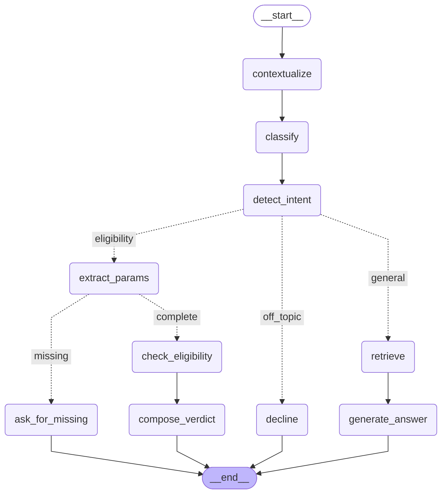

# SunGrid Cooperative Copilot

A prototype support copilot for the (fictional) SunGrid solar cooperative. It answers member
questions with retrieval-augmented generation over an internal knowledge base, and it calls
a separate eligibility service for rebate-eligibility questions instead of answering them
from documents.

> 🚧 Work in progress. Sections marked *TODO* are filled in as each part is built.

## Stack

| Concern | Choice |
|---|---|
| LLM + embeddings | [OpenRouter](https://openrouter.ai) (OpenAI-compatible API) |
| Vector store | Qdrant: Cloud free tier, or local embedded mode with no account |
| Query classifier | TypeSafe **Jev** (typed decision model), with an LLM fallback |
| Agent framework | LangGraph |
| Evaluation | DeepEval |

## Project layout

```
config/categories.yaml        category definitions + document→category tags (source of truth)
data/docs/                    the 14 knowledge-base documents
sungrid_copilot/
  config.py                   settings from environment / .env
  ingestion/                  chunking + embedding + upsert into Qdrant
  retrieval/                  category-filtered vector search
  classifier/                 query → category (Jev or LLM backend)
  agent/                      LangGraph agent
  integrations/stub_tools.py  eligibility service stub (unmodified, owned by "another team")
scripts/                      CLI entry points (ingest, ask)
evals/                        DeepEval test suite
tests/                        unit + guard tests
```

## Setup

Requires Python 3.10+.

```bash
python -m venv .venv
# Windows: .venv\Scripts\activate    macOS/Linux: source .venv/bin/activate
pip install -r requirements.txt
cp .env.example .env               # then fill in OPENROUTER_API_KEY (the only required key)
```

| Variable | Required | Notes |
|---|---|---|
| `OPENROUTER_API_KEY` | yes | Used for chat, embeddings and the eval judge |
| `QDRANT_URL`, `QDRANT_API_KEY` | no | Leave empty to use local embedded Qdrant |
| `TYPESAFE_API_KEY` | no | Leave empty to classify with the LLM fallback |

## Agent graph

Generated from the compiled LangGraph graph with `python -m scripts.draw_graph`. Solid arrows
are fixed edges and dotted arrows are conditional edges.

<!-- agent-graph:start -->

<!-- agent-graph:end -->

| Node | Responsibility |
|---|---|
| `contextualize` | Rewrites a follow-up ("how long do I have to appeal *that*?") into a standalone question using the last 3 exchanges. Skipped on the first turn. The rewrite drives classification, intent and retrieval |
| `classify` | Standalone query → one primary category plus retrieval filter (Jev or LLM). **Never chooses the path.** |
| `detect_intent` | The routing decision: eligibility check, general question, or off-topic. Aware of the conversation, so "what if it were 9 kW?" re-runs the check |
| `extract_params` | LLM structured extraction of the 4 eligibility inputs. All are optional, so nothing is guessed. Reads the member's **raw** message plus the question just asked (so "yes they're approved" resolves), never earlier values |
| `ask_for_missing` | Asks only for the missing inputs. The values given so far persist in the conversation thread |
| `check_eligibility` | **The only node that calls the eligibility service** (`stub_tools.check_rebate_eligibility`, unmodified) |
| `compose_verdict` | Hard gate: the verdict text comes from a code template, and an ineligible result never includes an amount |
| `retrieve` → `generate_answer` | Category-filtered vector search, then a grounded answer that cites its sources |
| `decline` | Polite refusal for off-topic queries |

## Running

```bash
python -m scripts.ingest              # build/refresh the vector store (idempotent; --recreate to rebuild)
python -m scripts.ask "When are bills issued?"
python -m scripts.ask                 # interactive multi-turn chat
python -m scripts.ask --debug ...     # also show category, filter, route, sources and tool calls
python -m scripts.draw_graph          # print the agent graph as Mermaid
pytest                                # unit + guard tests (no API keys needed)
```

*TODO*: evals.

## Assumptions

### 1. Single primary category, but the retrieval filter can be widened
The brief asks for a classifier that assigns **a single primary category** and uses
**that category** as a retrieval filter. The classifier always outputs exactly one primary
category (`Classification.primary`).

By default (`FILTER_MODE=widened`), the retrieval filter **also includes any runner-up
category with probability ≥ 0.10** (at most 3 categories). This departs from the most literal
reading of the brief on purpose:

- **Evidence:** for *"My rebate hasn't shown up on my bill, who do I contact?"* Jev returns
  `incentive_rebate 0.84 / billing_account 0.16`. The correct answer is in the **Billing & Account
  FAQs** doc. Filtering on the primary category alone hides it, and the top hit becomes a
  related but wrong section (score 0.588). The widened filter returns the exact answer
  first (score 0.748).
- **Why it's still a filter, not routing:** every relevant query runs the same retrieval step.
  The category only narrows which chunks are searched.
- **Literal behaviour is one setting away:** `FILTER_MODE=strict` filters on the primary category
  only. The eval suite runs both modes and compares them.

### 2. `non_relevant` queries skip retrieval
There is no category to filter to, so the copilot declines politely instead of searching.

### 3. Ambiguous documents are tagged with several categories
Doc 06 (rebate reversal / billing adjustment), doc 07 (installer certification) and doc 10
(low-income bill credit) are tagged with more than one category. The reasoning for each is
recorded next to the tag in `config/categories.yaml`. Doc 06's **primary** category is
`incentive_rebate`, because both the reversal decision and the appeal path belong to the
Incentive Program committee; Billing only executes the repayment schedule.

### 4. Weak filtered results fall back to an unfiltered search
If the best filtered hit scores below 0.45 (cosine), the classifier probably excluded the answer,
so retrieval runs again without a filter. The threshold comes from a small probe: relevant
queries scored 0.49–0.75 and an off-topic query scored 0.15. It is validated by the eval suite
rather than treated as final.

## Design doc

*TODO*: see `DESIGN.md`.
